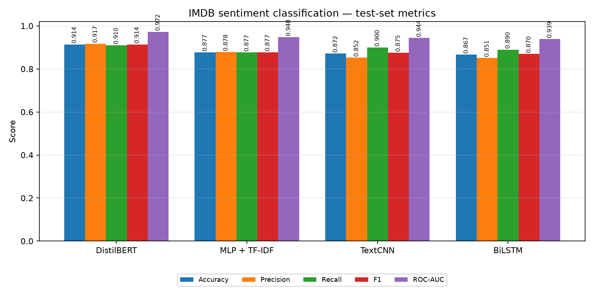

# Comparative Analysis of Deep Learning Architectures for Sentiment Classification of Movie Reviews

Deep Learning course project (ICT-4442), Manipal Institute of Technology.

**Team:** Hasil Haroon (230953019), T Rama Mohan Aniketh (230911224), Madhavan K (230953298), Ayrton Pulikottil (230953448)

Trains and compares four deep learning architectures for binary sentiment classification
(positive/negative) on the [IMDB Large Movie Review Dataset](https://ai.stanford.edu/~amaas/data/sentiment/):

| Model | Owner | Key idea |
|---|---|---|
| **MLP + TF-IDF** (baseline) | Hasil Haroon | 20k TF-IDF uni/bi-grams → one ReLU hidden layer |
| **TextCNN** | T Rama Mohan Aniketh | Embeddings → parallel 3/4/5-gram convolutions → max-pool |
| **BiLSTM** | Madhavan K | GloVe embeddings → single-layer BiLSTM → concat final states |
| **DistilBERT** | Ayrton Pulikottil | Fine-tuned `distilbert-base-uncased`, 3 epochs, max_len 256 |

The full write-up (methodology, results, error analysis, references) is available as a
submission-ready PDF: **[final_report.pdf](final_report.pdf)**. Its editable source is
**[final_report.tex](final_report.tex)**; the project-oriented Markdown version remains
in **[REPORT.md](REPORT.md)**.

## Results

All numbers are on the official 25,000-review IMDB test set, using one fixed split and a
single test evaluation per model. Models were selected on validation F1.

| Model | Test accuracy | Precision | Recall | F1 | ROC-AUC | Params | Train time |
|---|---|---|---|---|---|---|---|
| **DistilBERT** | 0.9141 | 0.9174 | 0.9102 | 0.9138 | 0.9723 | 66,955,010 | 643s |
| **MLP + TF-IDF** | 0.8774 | 0.8780 | 0.8766 | 0.8773 | 0.9477 | 2,560,257 | 73s |
| **TextCNN** | 0.8718 | 0.8523 | 0.8995 | 0.8753 | 0.9439 | 2,154,369 | 24s |
| **BiLSTM** | 0.8668 | 0.8509 | 0.8895 | 0.8698 | 0.9387 | 5,117,777 | 40s |



Confusion matrices: `results/figures/confusion_matrices.png` ·
validation curves: `results/figures/training_curves.png` ·
per-example DistilBERT errors: `results/error_analysis.md`.

DistilBERT is the strongest model, improving accuracy by **3.7 percentage points** over
the strongest non-transformer (the TF-IDF MLP). GloVe initialisation improves TextCNN
from 0.8408 to 0.8718 accuracy; it is the fastest neural model in this run. The error
analysis shows that DistilBERT is least accurate on the longest review quartile (0.8647)
and on reviews containing a negation cue (0.9081 versus 0.9322 without one).

## Dataset and splits

- 50,000 balanced IMDB reviews (25k train / 25k test) read from the official
  Hugging Face mirror (`stanfordnlp/imdb`), with a local `aclImdb/` directory supported
  as a fallback. English text, HTML stripped, whitespace collapsed.
- The official training set is shuffled (seed 42) and split 90/10 into
  **train (22,500)** and **validation (2,500)**; the official test set is untouched.
- TF-IDF features, TextCNN/BiLSTM vocabularies, and GloVe coverage are all built from the
  training split only, so validation and test text never leak into fitting.

## Repository layout

| Path | Purpose |
|---|---|
| `prepare_data.py` | Download, clean, and split the corpus → `splits.json` |
| `common.py` | Shared splits, seeding, GloVe loading, metrics |
| `train_mlp.py` | TF-IDF + MLP, 3-config validation grid |
| `train_textcnn.py` | TextCNN with random or GloVe embeddings, 3-config grid |
| `train_bilstm.py` | GloVe BiLSTM, 3-config grid with early stopping |
| `train_distilbert.py` | DistilBERT fine-tuning (2 learning rates), saves checkpoints |
| `compare.py` | Comparison table/CSV and figures in `results/` |
| `analyze_errors.py` | Length and negation slices + confident errors (DistilBERT) |
| `run_all.sh` | End-to-end reproduction |

## Quickstart

```bash
python3 -m venv .venv && source .venv/bin/activate
pip install -r requirements.txt          # PyTorch: use the CUDA wheel for GPU training

python3 prepare_data.py                  # ~40 MB download, writes splits.json
python3 train_mlp.py                     # CPU
python3 train_textcnn.py                 # GPU recommended
python3 train_bilstm.py                  # GPU recommended
python3 train_distilbert.py              # GPU strongly recommended
python3 compare.py                       # tables + figures
python3 analyze_errors.py                # optional, needs the DistilBERT checkpoint
```

Or run everything with `./run_all.sh`. GloVe (`glove-wiki-gigaword-100`) is downloaded
once to `~/.cache/glove/`; DistilBERT weights are cached in `.hf_cache/`.

## Training setup

| Component | Specification |
|---|---|
| CPU | 12th Gen Intel Core i5-12450H (12 threads) |
| RAM | 15 GB |
| GPU | NVIDIA GeForce RTX 3050 Laptop, 6 GB (CUDA 13.0, bf16) |
| OS / Python | Linux, Python 3.14 |
| Libraries | PyTorch 2.14.1, Transformers 5.22, scikit-learn 1.9 |

Training times in the results table are wall-clock for the selected configuration only
(the tuning grid and longer runs cost more; each JSON file records the full tuning time).

## Reproducibility notes

- Seeds are fixed (42) for Python, NumPy, PyTorch, and the train/validation split.
- Each training script writes `*_results.json` containing the full tuning grid, per-epoch
  history, selected configuration, and test metrics; `compare.py` only aggregates those files.
- `splits.json`, the raw data, GloVe cache, and model checkpoints are git-ignored; the
  scripts regenerate them deterministically.
- Minor run-to-run variation is expected from GPU nondeterminism; differences of a few
  tenths of a point should not be treated as significant.

## Known limitations

- One seed per configuration; no confidence intervals.
- Text is truncated at 200 (TextCNN), 256 (BiLSTM), 256 (DistilBERT) tokens.
- Hyperparameter grids are deliberately small.
- `analyze_errors.py` reflects only the DistilBERT checkpoint.
