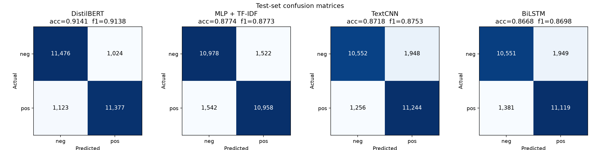
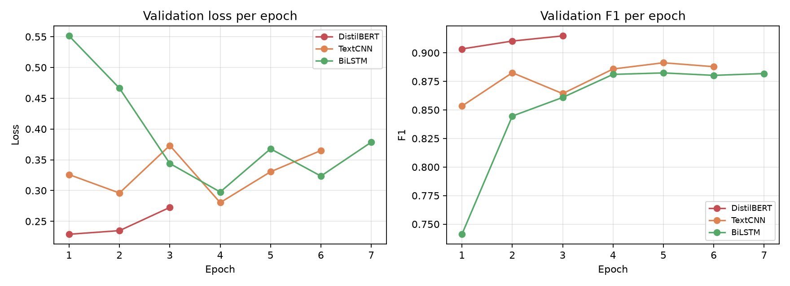

# Comparative Analysis of Deep Learning Architectures for Sentiment Classification of Movie Reviews

**Course:** ICT-4442 Deep Learning — Manipal Institute of Technology
**Team:** Hasil Haroon (230953019), T Rama Mohan Aniketh (230911224), Madhavan K (230953298), Ayrton Pulikottil (230953448)

---

## Abstract

We compare four deep learning architectures for binary sentiment classification on the IMDB Large Movie Review Dataset (50,000 reviews): a TF-IDF multi-layer perceptron baseline, a convolutional text classifier (TextCNN), a bidirectional LSTM with pretrained GloVe embeddings, and a fine-tuned DistilBERT transformer. All four models are trained and evaluated on an identical, fixed train/validation/test split, tuned on the validation set with a common protocol, and evaluated exactly once on the official 25,000-review test set. DistilBERT is the strongest model, reaching **0.9141** test accuracy and **0.9138** F1, followed by the TF-IDF MLP (**0.8774** / **0.8773**), the GloVe-initialised TextCNN (**0.8718** / **0.8753**), and the BiLSTM (**0.8668** / **0.8698**). The transformer gains 3.7 percentage points of accuracy over the strongest non-transformer model, while the well-regularised TF-IDF MLP remains competitive on a CPU-only budget.

## 1 Introduction

Sentiment analysis is a canonical sequence-classification problem: given a review, predict whether its overall polarity is positive or negative. Movie reviews are long, lexically diverse, and frequently mix praise and criticism in the same document, which makes the task a useful stress test for architectures with different inductive biases. Convolutional models capture local n-gram patterns, recurrent models aggregate information sequentially, and transformers model all pairwise token interactions through attention.

This project asks a practical question: how much accuracy does increasing architectural complexity actually buy on IMDB, and at what training cost? We implement four representative models within one preprocessing and evaluation pipeline, tune each on the same validation split, and report test accuracy, precision, recall, F1, ROC-AUC, confusion matrices, parameter counts, and wall-clock training time.

Contributions:

1. A reproducible, leakage-free pipeline (fixed splits, fixed seeds, JSON result artefacts) shared by all four models.
2. Tuned implementations of TextCNN, BiLSTM, and DistilBERT on top of the existing MLP baseline, with GloVe-initialised embeddings where applicable.
3. A controlled comparison of accuracy against training cost, plus a quantitative error analysis of the best model.

## 2 Related Work

Pang and Lee [1] survey classical feature-engineering approaches to sentiment classification. Maas et al. [2] introduced the Large Movie Review Dataset used here and showed that unsupervised word vectors add substantial signal on top of bag-of-words features. Kim [3] introduced TextCNN, applying one-dimensional convolutions with multiple kernel widths and global max-pooling to sentence classification; it remains a strong, cheap baseline for sentence and document polarity. Hochreiter and Schmidhuber [4] introduced the LSTM to address vanishing gradients in recurrent networks; bidirectional variants [5] encode both left and right context. Vaswani et al. [6] replaced recurrence with self-attention, and Devlin et al. [7] showed that pre-training a transformer on large unlabelled corpora and fine-tuning it yields state-of-the-art results on many classification tasks. DistilBERT [8] distils BERT into a six-layer model that retains most of its accuracy at roughly half the parameters and substantially lower inference cost, making it practical on consumer hardware. Our embedding initialisation uses GloVe [9], and all neural models are trained with Adam [10] and dropout [11].

## 3 Dataset and Preprocessing

We use the IMDB Large Movie Review Dataset [2]: 50,000 labelled reviews, balanced between positive and negative, with 25,000 examples for training and 25,000 for testing. The dataset is read from the official Hugging Face mirror (`stanfordnlp/imdb`), which is a copy of the original `aclImdb` release.

Preprocessing is shared by every model (`prepare_data.py`):

- HTML tags are stripped with a regular expression, newlines and repeated whitespace are collapsed, and the text is stripped of leading/trailing spaces.
- The official training set is shuffled once with seed 42 and split 90/10 into train (22,500) and validation (2,500) sets. The validation split is used only for model selection.
- The official test set (25,000) is never used for tuning; it is evaluated once per selected model.

Class balance is preserved by the shuffle (train 50.06% positive, validation 49.44%, test 50.00%). No test review appears in training, and no model sees validation or test text during fitting. The MLP uses TF-IDF features fitted on the training split only; token vocabularies for TextCNN and BiLSTM are also built from the training split only.

## 4 Models

### 4.1 MLP + TF-IDF (baseline)

A sparse TF-IDF representation (unigrams and bigrams, 20,000 features, `min_df=2`, English stop-words removed) is fed to a scikit-learn `MLPClassifier` with one ReLU hidden layer, Adam, batch size 128, and early stopping on an internal 10% split. Hidden size and L2 regularisation are selected on the validation split over {128, 256} × {1e-4, 1e-3}. This is the "no sequence structure, no pretraining" control.

### 4.2 TextCNN

Following Kim [3], each token is mapped to a 100-dimensional embedding. Three parallel one-dimensional convolutions with kernel widths 3, 4, and 5 (100 feature maps each) produce feature maps that are max-pooled over time and concatenated, followed by dropout (0.5) and a linear classifier. Reviews are truncated/padded to a fixed length (200 or 300 tokens). Three configurations are compared: randomly initialised trainable embeddings at length 200 (the interim setup), GloVe-initialised embeddings at length 200, and GloVe-initialised embeddings at length 300 with 128 filters per width. Embeddings are fine-tuned in all GloVe configurations.

### 4.3 BiLSTM

Tokens are embedded with 100-dimensional GloVe vectors (frozen or fine-tuned) and passed through a single-layer bidirectional LSTM with hidden size 128 (or 256). The final forward and backward hidden states are concatenated, dropout (0.4–0.5) is applied, and a linear layer produces the logit. Sequences are packed by length so padding does not contribute to the recurrence; gradients are clipped at norm 5. Three configurations are compared, varying hidden size, dropout, learning rate, and whether the embedding matrix is frozen.

### 4.4 DistilBERT

`distilbert-base-uncased` [8] is fine-tuned end to end with a two-class classification head. Inputs are tokenised with the WordPiece tokenizer, truncated/padded to 256 tokens. We use AdamW (weight decay 0.01), a linear learning-rate schedule with 10% warm-up, batch size 32, three epochs, gradient clipping at 1.0, and bfloat16 autocast. Two learning rates (2e-5 and 3e-5) are compared on the validation split; the checkpoint with the best validation F1 is kept for testing.

## 5 Experimental Setup

**Hardware.**

| Component | Specification |
|---|---|
| CPU | 12th Gen Intel Core i5-12450H (12 threads) |
| RAM | 15 GB |
| GPU | NVIDIA GeForce RTX 3050 Laptop, 6 GB (CUDA 13.0, bf16) |
| OS / Python | Linux, Python 3.14 |
| Libraries | PyTorch 2.14.1, Transformers 5.22, scikit-learn 1.9 |

**Protocol.** Every model is selected on validation F1, which balances precision and recall on a balanced test set; ties are broken by validation accuracy. The selected configuration is then evaluated once on the official test set. This avoids selecting on test data and keeps the four models comparable.

**Metrics.** Accuracy, precision, recall, F1, and ROC-AUC on the positive class, plus the 2×2 confusion matrix. Parameter counts exclude the frozen TF-IDF vocabulary and report trainable parameters for neural models.

**Reproducibility.** All scripts fix Python, NumPy, and PyTorch seeds at 42, use deterministic split files (`splits.json`), and write machine-readable results to `*_results.json`. `run_all.sh` reproduces the study end to end.

## 6 Results

### 6.1 Main comparison

| Model | Test accuracy | Precision | Recall | F1 | ROC-AUC | Params | Train time |
|---|---|---|---|---|---|---|---|
| **DistilBERT** | 0.9141 | 0.9174 | 0.9102 | 0.9138 | 0.9723 | 66,955,010 | 643s |
| **MLP + TF-IDF** | 0.8774 | 0.8780 | 0.8766 | 0.8773 | 0.9477 | 2,560,257 | 73s |
| **TextCNN** | 0.8718 | 0.8523 | 0.8995 | 0.8753 | 0.9439 | 2,154,369 | 24s |
| **BiLSTM** | 0.8668 | 0.8509 | 0.8895 | 0.8698 | 0.9387 | 5,117,777 | 40s |

### 6.2 Discussion

DistilBERT produced the best result on every aggregate metric. Its 0.9141 accuracy is 3.7 percentage points above the TF-IDF MLP, the strongest non-transformer. That improvement came with substantially more capacity (67.0M trainable parameters) and a 643-second selected-configuration training run, compared with 2.56M parameters and 73 seconds for the MLP. These wall-clock times are environment-specific, but they make the accuracy/compute trade-off concrete.

Among the sequence models trained from scratch, GloVe-initialised TextCNN was the most efficient: its best configuration reached 0.8718 accuracy in 24 seconds. GloVe was material: the random-initialised TextCNN reached 0.8408, while the GloVe version with 300-token inputs reached 0.8718. TextCNN and BiLSTM have higher recall than precision, indicating a modest tendency to predict positive sentiment; the MLP and DistilBERT are more balanced. The MLP's strong result also shows that IMDB contains enough discriminative lexical and phrase-level signal for a sparse baseline to remain competitive.

### 6.3 Error analysis

The selected DistilBERT checkpoint correctly classified 22,853 of 25,000 test reviews. Accuracy was stable for reviews up to 273 words (0.9201–0.9381 across the first three length quartiles), but fell to 0.8647 for the longest quartile (274–2,235 words), consistent with the 256-token truncation limit and the greater ambiguity of long reviews. Reviews containing a negation cue were also harder: 0.9081 accuracy versus 0.9322 for the remaining reviews. Several highly confident apparent errors contain strongly positive or negative language that conflicts with the assigned label, illustrating the label noise and mixed sentiment inherent in review corpora. The detailed slices and examples are in `results/error_analysis.md`.

## 7 Limitations and Future Work

- **Single seed.** Each configuration is trained once. Differences of a few tenths of a point — for example between the two strongest models — are within the run-to-run variance typically observed on IMDB; confidence intervals over 3–5 seeds would make the ranking statistically defensible.
- **Truncation.** TextCNN and BiLSTM see the first 200–300 tokens and DistilBERT the first 256, so evidence appearing late in long reviews is invisible to the model. Hierarchical or chunked encoders could address this.
- **Limited tuning budget.** We search small, sensible grids per family rather than running full random/Bayesian search; DistilBERT in particular would likely benefit from longer training or layer-wise learning-rate decay.
- **Frozen benchmark.** We evaluate on the standard IMDB test set, which is widely used and may be mildly saturated; cross-domain or out-of-distribution evaluation would test generalisation more strictly.
- **Compute reporting.** Wall-clock times reflect a single laptop GPU shared with other processes and should be read as orders of magnitude, not precise benchmarks.

## 8 Conclusion

On a common IMDB split, a fine-tuned DistilBERT model is the most accurate architecture (0.9141 accuracy, 0.9138 F1), and the gap to classical and convolutional baselines is consistent with the literature on pretrained transformers. Among the models trainable from scratch, GloVe-initialised TextCNN is the best accuracy-per-second choice, while a TF-IDF MLP remains a surprisingly strong low-cost baseline. The experiment also shows that the marginal accuracy from added architectural complexity is modest compared with the effect of pretraining: initialising embeddings with GloVe alone moves TextCNN close to the recurrent model at a fraction of the training time.

## References

1. B. Pang and L. Lee. *Opinion Mining and Sentiment Analysis.* Foundations and Trends in Information Retrieval, 2(1–2), 2008.
2. A. L. Maas, R. E. Daly, P. T. Pham, D. Huang, A. Y. Ng, and C. Potts. *Learning Word Vectors for Sentiment Analysis.* ACL, 2011.
3. Y. Kim. *Convolutional Neural Networks for Sentence Classification.* EMNLP, 2014.
4. S. Hochreiter and J. Schmidhuber. *Long Short-Term Memory.* Neural Computation, 9(8), 1997.
5. M. Schuster and K. K. Paliwal. *Bidirectional Recurrent Neural Networks.* IEEE Transactions on Signal Processing, 45(11), 1997.
6. A. Vaswani et al. *Attention Is All You Need.* NeurIPS, 2017.
7. J. Devlin, M.-W. Chang, K. Lee, and K. Toutanova. *BERT: Pre-training of Deep Bidirectional Transformers for Language Understanding.* NAACL, 2019.
8. V. Sanh, L. Debut, J. Chaumond, and T. Wolf. *DistilBERT, a Distilled Version of BERT: Smaller, Faster, Cheaper and Lighter.* NeurIPS Workshop on Energy Efficient Machine Learning and Cognitive Computing, 2019.
9. J. Pennington, R. Socher, and C. D. Manning. *GloVe: Global Vectors for Word Representation.* EMNLP, 2014.
10. D. P. Kingma and J. Ba. *Adam: A Method for Stochastic Optimization.* ICLR, 2015.
11. N. Srivastava, G. Hinton, A. Krizhevsky, I. Sutskever, and R. Salakhutdinov. *Dropout: A Simple Way to Prevent Neural Networks from Overfitting.* JMLR, 15(1), 2014.

## Appendix A — Per-configuration validation results

| Model | Configuration | Val F1 | Test acc | Test F1 | Params | Train time |
|---|---|---|---|---|---|---|
| MLP | hidden=[128], alpha=0.0001 | 0.8913 | 0.8770 | 0.8768 | 2,560,257 | 72s |
| MLP | hidden=[256], alpha=0.0001 | 0.8878 | 0.8756 | 0.8754 | 5,120,513 | 149s |
| MLP ✓ | hidden=[128], alpha=0.001 | 0.8917 | 0.8774 | 0.8773 | 2,560,257 | 73s |
| TextCNN | random init, len=200, filters=100 | 0.8563 | 0.8408 | 0.8529 | 2,120,601 | 17s |
| TextCNN | GloVe init, len=200, filters=100 | 0.8809 | 0.8599 | 0.8606 | 2,120,601 | 17s |
| TextCNN ✓ | GloVe init, len=300, filters=128 | 0.8913 | 0.8718 | 0.8753 | 2,154,369 | 24s |
| BiLSTM | hidden=128, len=256, frozen embeddings | 0.8467 | 0.8437 | 0.8538 | 235,777 | 36s |
| BiLSTM ✓ | hidden=128, len=256, fine-tuned embeddings | 0.8824 | 0.8668 | 0.8698 | 5,117,777 | 40s |
| BiLSTM | hidden=256, len=256, fine-tuned embeddings | 0.8800 | 0.8623 | 0.8673 | 5,615,697 | 87s |
| DistilBERT ✓ | lr=2e-5, len=256, batch=32 | 0.9148 | 0.9141 | 0.9138 | 66,955,010 | 643s |
| DistilBERT | lr=3e-5, len=256, batch=32 | 0.9120 | 0.9136 | 0.9132 | 66,955,010 | 614s |

## Appendix B — Repository layout

| Path | Purpose |
|---|---|
| `prepare_data.py` | Downloads/cleans the corpus and writes `splits.json` |
| `common.py` | Shared splits, seeding, GloVe loading, metrics |
| `train_mlp.py` | TF-IDF + MLP baseline with a small hyperparameter grid |
| `train_textcnn.py` | TextCNN with random or GloVe embeddings |
| `train_bilstm.py` | GloVe-initialised bidirectional LSTM |
| `train_distilbert.py` | DistilBERT fine-tuning |
| `compare.py` | Builds the comparison table, CSV, and figures |
| `analyze_errors.py` | Length/negation slices and confident errors for DistilBERT |
| `run_all.sh` | End-to-end reproduction script |

## Appendix C — Team contributions

| Member | Contribution |
|---|---|
| Hasil Haroon | Data pipeline, MLP + TF-IDF baseline, experiment tracking |
| T Rama Mohan Aniketh | TextCNN implementation, GloVe integration, tuning |
| Madhavan K | BiLSTM implementation and tuning |
| Ayrton Pulikottil | DistilBERT fine-tuning and error analysis |
